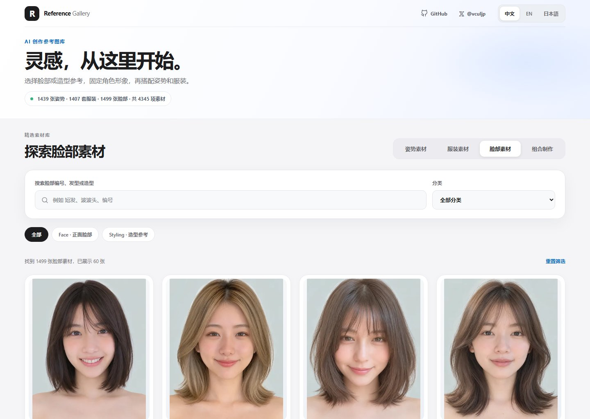
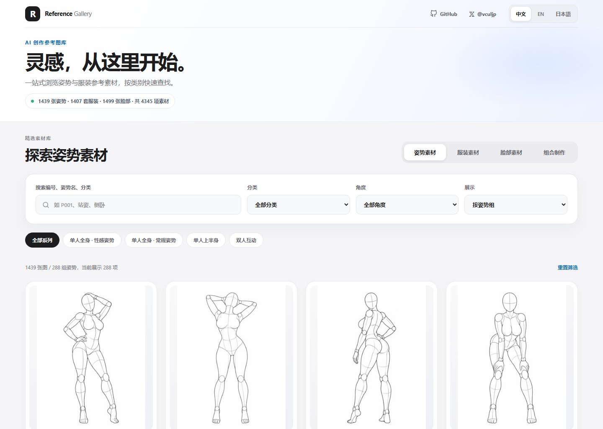
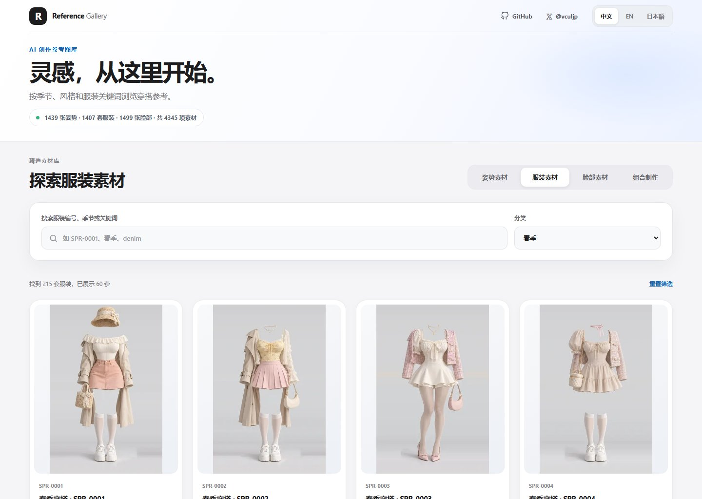
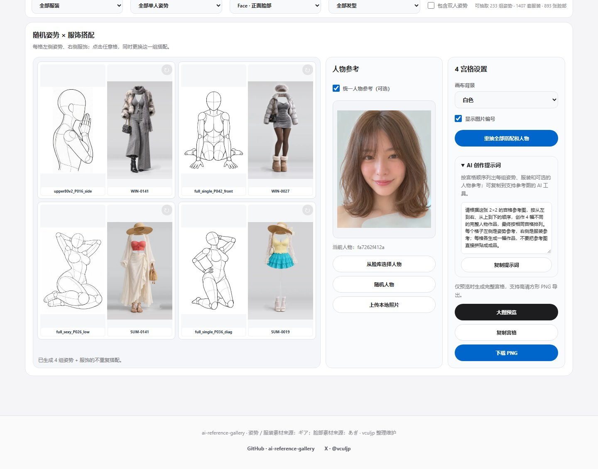

# AI Reference Gallery

> **4,345 条 AI 创作参考素材：姿势 × 服装 × 脸部造型。**
> 一个支持双图、三图、四宫格、九宫格和 Agent Skill 的开源参考图工具。**不直接生图、不自动换装或换脸**，而是为 AI 创作整理可以直接使用的视觉参考与提示词。

[在线体验](https://gallery.zsj.pp.ua/) · [GitHub 源码](https://github.com/vculjp/ai-reference-gallery) · [作者 X @vculjp](https://x.com/vculjp)

## 页面预览

| 脸部素材页 | 姿势库素材页 |
| :---: | :---: |
|  |  |
| **服饰素材页** | **随机四宫格素材页** |
|  |  |

四宫格图来自网页真实的「**重新随机全部**」功能：每次从图库中随机抽取 **4 组不同姿势＋4 套不同服饰**，每格展示一组完整搭配；上图是其中一次随机生成的页面截图。你可以在 [在线体验](https://gallery.zsj.pp.ua/) 中重新随机，获取不同组合。

## 主要功能

| 模块 | 能做什么 |
| --- | --- |
| **姿势图库** | 1,439 张姿势图（288 组），按系列、分类、视角、关键词搜索，支持原图预览与下载 |
| **服装图库** | 1,407 套穿搭素材，支持季节、风格、编号筛选 |
| **脸部图库** | 1,499 张参考图（Face 893 / Styling 606），按用途、发型与关键词筛选 |
| **双图 / 三图** | 姿势＋服装＋可选人物参考；支持随机搭配、选择脸库素材或上传自己的照片 |
| **四宫格 / 九宫格** | 每格都是一组**姿势＋服装**搭配，可统一使用一张脸部参考；支持整组重抽、单格重抽和去重 |
| **导出与提示词** | 预览、复制或下载 PNG，自动整理与当前参考图对应的 AI 创作提示词 |
| **多语言与离线** | 简体中文、English、日本語；网页使用原生 HTML / CSS / JavaScript，无后端依赖 |

网页宫格输出：四宫格 **2048×2048**，九宫格 **3072×3072**。统一人物参考可以从脸库随机选择、手动选择，或上传自己的照片；上传的照片只在浏览器本地参与拼图。导出的是**创作参考板**，并非 AI 生成的最终人物图。

## 网页怎么用

直接打开 [在线预览](https://gallery.zsj.pp.ua/)：浏览姿势／服装／脸部图库，或进入「组合制作」，切换双图、三图、四宫格、九宫格，选择或随机搭配素材，然后复制图片、下载 PNG 或复制提示词。

本地离线版：

```bash
git lfs install
git clone https://github.com/vculjp/ai-reference-gallery.git
cd ai-reference-gallery
git lfs pull
```

下载完整素材后双击 `index.html` 即可打开。网页本身**无需 npm、后端或构建**。通过 `file://` 导出使用本地原图的组合图时，按提示选择本项目的 `img/` 文件夹；使用同源 HTTP 网站时无需授权文件夹。

**素材下载提示：**姿势与服装资源随 Git 仓库提供；新增脸库的 1,499 张高清 PNG 使用 **Git LFS** 管理，原图约 4.5 GiB。克隆前请预留空间，且需确保发布方已将 LFS 对象上传到远程，否则脸部高清预览和导出可能不可用。在线演示是否包含新功能以实际部署版本为准。

## Agent Skill：无需下载整个图库

项目内置 [独立 Agent Skill](.agents/skills/ai-reference-gallery/SKILL.md)，可在 Codex 等兼容 Agent Skills 的助手中安装仓库子目录 `.agents/skills/ai-reference-gallery/`，无需克隆多 GB 原图库。

- 支持自然语言规则筛选、素材 ID、分类和随机种子；无法理解的条件会明确反馈，不会冒充图像语义识别。
- 支持批量双图／三图、**组合四宫格／九宫格**；Skill 还独有**单图宫格**（每格一张姿势或服装）。
- 可从脸库选定统一人物参考，也可使用自己的照片；按需下载选中的原图并缓存，不下载整库。
- 每次导出生成 **PNG 参考图＋TXT 提示词＋JSON 素材记录**。

示例：安装 Skill 后，可在任意工作目录用自然语言请求：

> 用春季穿搭和自然站姿随机生成 9 组不重复搭配，做一个九宫格，附上每格的提示词。

也可以从仓库内调用 CLI：

```bash
# 查询脸部素材
node bin/ai-reference-gallery.cjs catalog --type portrait --limit 5

# 九组姿势＋服装的组合宫格
node bin/ai-reference-gallery.cjs grid --size 9 --grid-mode pairs --describe "春季自然站姿，不要性感风格" --out output/nine-grid.png

# 单图姿势九宫格（Skill 模式）
node bin/ai-reference-gallery.cjs grid --size 9 --grid-mode single --grid-source pose --out output/poses.png
```

Skill 的查询不需要浏览器；**导出 PNG 需要 Node.js 22+ 和 Chrome / Edge**，未缓存的原图首次导出需要网络。完整安装和参数见 [Skill 使用说明](.agents/skills/ai-reference-gallery/references/usage.md)。

## 给开发者

- [Catalog v1 素材接口](docs/catalog-api.md)：从三套静态索引生成版本化 JSON 清单，支持本地 CLI / Node.js 查询；**不是在线 HTTP API**。
- [分发与发布说明](docs/distribution.md)：独立 Skill、GitHub Release、npm CLI 打包及 CI 流程。**npm 包只有正式发布后才能通过 npm / npx 获取**。
- [贡献指南](CONTRIBUTING.md)：代码规范、测试和素材授权注意事项。

## 版权与致谢

项目**代码**采用 [MIT License](LICENSE)；图片及来源衍生数据不自动适用 MIT，使用或再分发请遵守 [ASSETS.md](ASSETS.md) 所述授权条件。

素材来源与原作者：
- [AI Pose Gallery](https://ai-pose-gallery.pages.dev/)（姿势）与 [AI Costume Gallery](https://ai-costume-gallery.pages.dev/)（服装）：**ギア**（[@giaaibusi](https://x.com/giaaibusi)）。
- [AI Portrait Gallery](https://ai-portrait-gallery.pages.dev/)（脸部与造型）：**あぎ**。

本项目由 [@vculjp](https://x.com/vculjp) 整理维护，不代表上述素材网站的官方项目。
