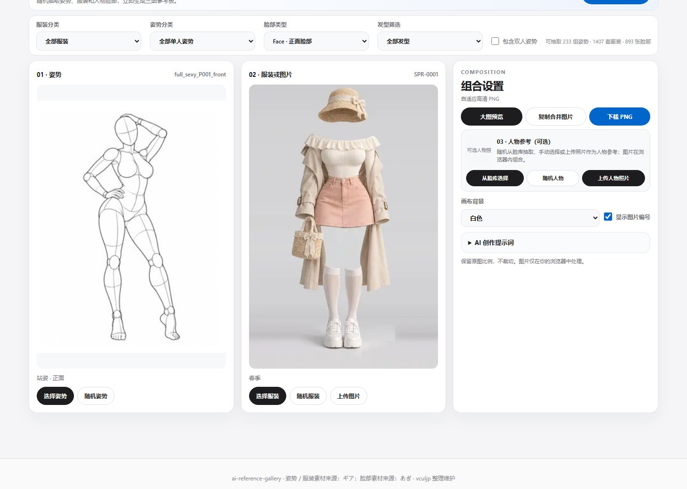
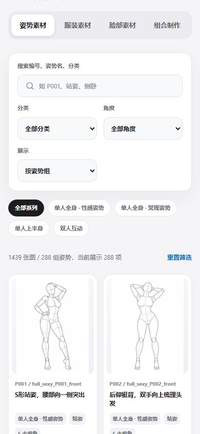

# AI Reference Gallery

**把姿势、服装和人物照片组合成一张 AI 创作参考图。**

一个纯静态、可离线使用的参考图组合工作台。网页支持挑选素材、一键随机搭配与双图 / 三图参考板；独立安装的 **Agent Skill** 还支持自然语言选图、四宫格 / 九宫格和批量导出。生成的参考图可配合提示词交给支持图片参考的 AI 工具使用。



## 核心功能：组合制作

桌面端采用 **姿势｜服装｜组合设置** 三栏等宽布局，移动端自动调整排版。人物参考上传入口放在「组合设置」内，无需跳转页面。

| 姿势参考 | 服装参考 | 组合设置 |
| --- | --- | --- |
| 从图库选择姿势，或随机抽取 | 从图库选择服装、随机抽取，或上传自己的图片 | 上传可选人物照片，设置背景、预览、复制与导出 |

### 双图 / 三图参考板

- **双图模式**：姿势 + 服装。适合将动作和穿搭要求整理成一张参考图。
- **三图模式**：姿势 + 服装 + 人物照片。人物照片用于提示 AI 参考面部与发型等特征；移除照片即可恢复双图模式。
- **随机找灵感**：支持一键随机组合、仅随机姿势或仅随机服装；可限制姿势和服装分类，并选择是否包含双人姿势。
- **固定顺序**：从左到右依次显示姿势、服装、可选人物参考；可选择白色或浅灰背景，以及显示或隐藏图库图片编号。上传的图片没有图库编号，不会显示假编号。图片等比例完整呈现，不强制裁切。
- **按需大图预览**：点击「大图预览」才打开弹窗；可直接复制合并图片或下载 PNG。
- **AI 创作提示词**：自动描述每张参考图的用途及对应位置，支持一键复制文本。

> 本项目负责**参考素材组合与提示词整理**，不调用 AI 生图服务，也不提供自动换装或人脸替换。

## 如何使用

1. 打开「**组合制作**」，选择姿势和服装，或者点击「**一键随机组合**」。
2. 如需保持特定人物形象，在「**组合设置**」中上传人物照片；不上传也能直接制作双图。
3. 设置背景及是否显示图库编号，点击「**大图预览**」查看效果。
4. 复制图片、下载 PNG，或展开「**AI 创作提示词**」复制说明，提供给你的 AI 绘图工具。

## 素材库与其他功能

项目内置 **288 组 / 1,439 张姿势参考图**、**1,407 套服装素材**，支持分类、关键词、多角度浏览和原图下载，并提供简体中文、English、日本語界面。

<details>
<summary>查看素材图库与移动端截图</summary>

**姿势图库**


**服装图库**


**移动端**



</details>

## 快速开始

```bash
git clone https://github.com/vculjp/ai-reference-gallery.git
cd ai-reference-gallery
```

直接打开 **`index.html`** 即可使用，仓库内包含所需图片资源。网页由原生 HTML、CSS 和 JavaScript 构成，无需后端或运行依赖。

**本地导出注意**：通过 `file://` 打开时，复制或导出组合图需要根据页面提示授权读取项目的 **`img` 文件夹**（含 `pose/` 和 `costume/`）；通过同源 HTTP 网站访问则无需此步骤。复制图片还需要浏览器支持图片剪贴板功能，不能复制时可使用 PNG 下载。

## Agent Skill：用自然语言制作参考图

除了网页操作，项目还提供可供 **Codex 等兼容 Agent Skills 的助手**使用的 [`ai-reference-gallery` Skill](.agents/skills/ai-reference-gallery/SKILL.md)。**只安装 Skill 就能搜索素材和生成参考图，不需要克隆整个图库，也不需要手动下载几千张图片。** Skill 自带压缩索引与 Canvas 渲染代码，首次生成时按需下载选中的原图，之后自动复用本地缓存。

| 能力 | 效果 |
| --- | --- |
| 素材搜索 | 中文 / 英文 / 日文关键词、分类、姿势角度与真实素材编号 |
| 自然语言选图 | `--describe` 识别季节、姿势、部分角度、自然日常偏好及排除条件；无法识别的风格会明确列出 |
| 随机搭配 | 按条件选姿势和服装，支持固定随机种子、锁定素材，宫格在未锁定素材时避免重复 |
| 双图 / 三图 | 姿势 + 服装 + 可选本地人物照片；也可上传自己的服装照片 |
| 批量制作 | 一次生成最多 20 组独立的 PNG 参考板 |
| 双模式宫格 | `pairs`：每格一组姿势＋服装；`single`：每格只放一张姿势图或服装图 |
| 宫格尺寸 | 2×2 四宫格 / 3×3 九宫格；单图模式支持 1:1 方形及 3:4 竖版 |
| 环境与缓存 | `doctor` 环境诊断、按需下载、备用源、SHA-256 缓存校验及下载进度 |
| 提示词与记录 | 同时导出 `.txt` 提示词和 `.json` 素材编号、格子位置等信息 |

### 四宫格 / 九宫格效果

**组合四宫格（`pairs`）：**一张图展示 4 组不同的姿势与服装搭配。


**组合九宫格（`pairs`）：**从站姿与春季服装中随机抽取 9 组组合，**每格的姿势与服装都不重复**。


**单图宫格（`single`）：**每格只显示一张姿势图或服装图，可选择方形 2400×2400 或竖版 2400×3200，素材按比例完整显示。

> 所有宫格均为**已有参考素材的排版**，不是 AI 自动换装或生成真人照片。以上宫格命令属于 **Skill**；当前仓库已发布的网页版本以双图 / 三图组合为主。

### 安装 Skill（不需要下载图库）

使用 Codex 自带的 Skill 安装器安装**子目录** `.agents/skills/ai-reference-gallery`（而不是整个仓库），安装完成后重启 Codex 即可在任意项目中调用。例如 Windows PowerShell：

```powershell
python "$env:USERPROFILE\.codex\skills\.system\skill-installer\scripts\install-skill-from-github.py" --repo vculjp/ai-reference-gallery --path .agents/skills/ai-reference-gallery --method git
```

已安装旧版 Skill 的用户需要更新或重新安装才能获得新功能。安装后重启 Codex，即可在**任意工作目录**使用，不要求在网页仓库中运行。

### 用自然语言调用

> `$ai-reference-gallery` 帮我找 9 组春季自然站姿，不要性感风格，姿势和服装都不能重复。生成一张九宫格组合参考图，并输出每格的提示词。

Skill 会用本地分类与关键词规则筛选素材，**不依赖额外 AI API，也不具备对图片风格的视觉识别**。例如「日系」等当前没有可靠分类依据的描述，会在 JSON 中标为 `unsupported`，而不会假装匹配成功。

### 直接使用命令行

也可以在任意目录直接运行（无需启动网站或下载整个图库）。以下是 Windows PowerShell 示例：

```powershell
$skill = "$env:USERPROFILE\.codex\skills\ai-reference-gallery\scripts\gallery.cjs"

# 1. 检查 Node.js、Chrome/Edge、Skill 运行文件及缓存权限
node $skill doctor

# 2. 搜索真实姿势素材（无需联网）
node $skill search --type pose --query "站姿" --limit 5

# 3. 通过自然语言筛选春季服装（可查看 matched / unsupported）
node $skill search --type outfit --describe "春季穿搭，不要性感风格" --limit 5

# 4. 批量生成 5 张独立的双图参考板
node $skill compose --pose-category 站姿 --count 5 --seed demo --out-dir output/demo

# 5. 组合四宫格：每格姿势＋服装
node $skill grid --size 4 --grid-mode pairs --pose-category 站姿 --outfit-category spring --seed four-demo --out output/four-grid.png

# 6. 组合九宫格：按自然语言规则随机选取 9 组不重复的搭配
node $skill grid --size 9 --grid-mode pairs --describe "春季自然站姿，不要性感风格" --seed spring-demo --out output/nine-grid.png

# 7. 单图九宫格：每格一张不同的姿势图
node $skill grid --size 9 --grid-mode single --grid-source pose --pose-category 站姿 --out output/poses.png

# 8. 单图四宫格：每格一套不同服装，3:4 竖版
node $skill grid --size 4 --grid-mode single --grid-source outfit --outfit-category spring --aspect portrait --out output/outfits.png

# 9. 加入自己的角色照片，生成三图参考板
node $skill compose --pose-id full_sexy_P001_front --outfit-id SPR-0001 --person "C:/Photos/person.png" --out output/my-reference.png
```

每个输出名称对应三个文件：`xxx.png`（实际合成图）、`xxx.txt`（可复制的 AI 创作提示词）、`xxx.json`（使用的素材和生成信息）。宫格 JSON 还记录每格的位置、素材编号与模式；`--seed` 可复现相同的随机选图结果。**默认不覆盖已存在文件**，需要覆盖时显式传入 `--overwrite`。

**运行要求：**Node.js **22+** 和本机 **Chrome 或 Edge**（`doctor`、`search`、`categories` 无需启动浏览器）。未缓存的素材首次导出需要网络，下载源为项目静态图库，失败时尝试 GitHub Raw；也可指定可信的 `AI_REFERENCE_ASSET_BASE`。本地缓存位于 `~/.cache/ai-reference-gallery/img/`，使用 SHA-256 检查文件变化，损坏时按需重新下载；可通过 `AI_REFERENCE_CACHE_DIR` 修改缓存目录。本地人物照片不会上传到外部服务。无需 npm 依赖、API Key 或云端生图服务。生成文件默认写入**当前工作目录**下的 `output/skill-compositions/` 或 `output/skill-grids/`。

**常见问题：**运行失败先执行 `node $skill doctor`；提示素材不足时放宽筛选，宫格不会在未锁定素材时以重复图片凑数；下载失败时检查网络连接或配置可信静态源；旧版本不认识 `--describe`、`--grid-mode` 时需要重新安装 Skill。

更多参数、批量生成和问题排查请看 [Skill 使用说明](.agents/skills/ai-reference-gallery/references/usage.md)。

## 项目文件

- `index.html` / `app.js`：网页入口与图库交互。
- `composition-ui.js` / `composition.js`：组合工作台、Canvas 拼接与 PNG 导出。
- `composition.css` / `style.css`：组合制作与图库样式。
- `i18n.js`：中英日多语言。
- `catalog.js` / `costume-catalog.js` / `img/`：素材索引与本地图像。

## 版权与致谢

- **项目维护者 X**：[@vculjp](https://x.com/vculjp)。
- **代码**采用 [MIT License](LICENSE)；图片、缩略图及来源衍生索引**不适用 MIT 代码许可**，使用和再分发请参阅 [ASSETS.md](ASSETS.md)。
- **姿势素材**：[AI Pose Gallery](https://ai-pose-gallery.pages.dev/)；**服装素材**：[AI Costume Gallery](https://ai-costume-gallery.pages.dev/)。
- **原作者**：ギア（[@giaaibusi](https://x.com/giaaibusi)）。
